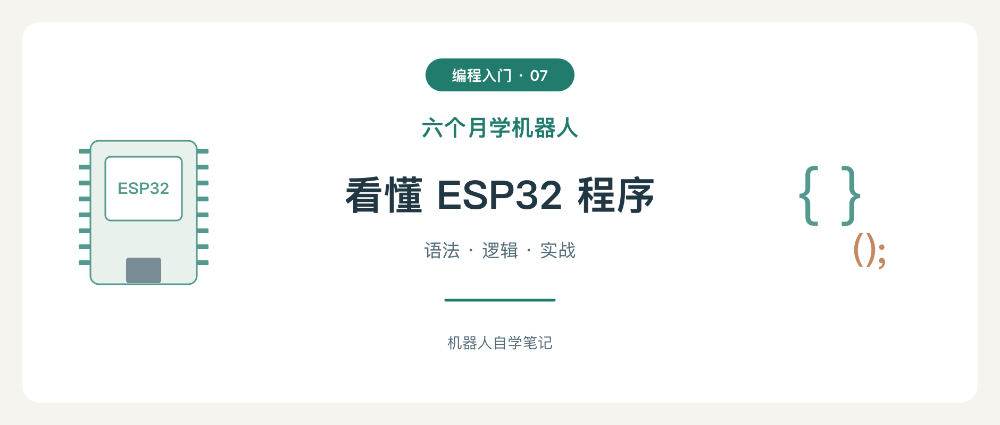

# Arduino / ESP32 语法入门 · 六个月学机器人⑦

从零读懂并写出程序：通用语法、完整示例，以及输入输出、屏幕和联网的实际用法。

「六个月学机器人」是机器人自学笔记系列。后续内容会在微信公众号「极客行动」上更新，欢迎关注。

- [阅读完整文章](article.md)
- [19 个程序：16 个课程快照与 3 个独立练习](#配套代码)
- [封面与机制图](images/)
- [验证与版本](VALIDATION.md)



## 配套代码

- `sketches/`：16 份课程示例快照（本文写作时的课程版本），每个目录是一份可单独打开的 sketch。
- `examples/syntax_lab/`：仅用串口串联函数、数组、引用、对象、String 和 Lambda。
- `examples/cooperative_timing/`：两个独立节奏的非阻塞计时。
- `examples/serial_control/`：串口发送 `1`、`0`、`?` 控制与查询 LED。

示例基线：Arduino-ESP32 **3.3.12**、ESP32-WROOM-32E、FQBN `esp32:esp32:esp32`、串口 **115200**。详细来源见 [VERSION.json](VERSION.json)。

[网站课程](https://aigeekops.github.io/learn-esp32)现已扩展到 25 课（原有课程重排，并新增 9 课机器人专题：超声波测距、直流电机、编码器测速、PI 调速、双轮差速、UART 通信、BLE 遥控、ESP-NOW 通信、综合双轮机器人）。这里是独立学习材料和代码快照，按主题对照，不按网站课号，也不当作课程源码的实时副本。

## 重新生成配图

需要 Node.js，并安装支持中文的字体，如 PingFang SC、Microsoft YaHei 或 Noto Sans CJK SC。

```sh
cd tutorials/arduino-esp32-syntax/tools
npm install
npm run render
```

`render-assets.mjs` 保留封面与三张机制图的全部布局和文字，生成 SVG、PNG 及居中方形封面预览。画布采用系列的米白、深绿配色；横版封面为 1880×800，标题在中心方形裁切内完整可见。

## 许可与验证

原创文章、示例与绘图代码采用 [MIT](LICENSE)。外部参考、商标和第三方依赖保留各自权利。编译通过与实际烧录、测量是不同验证阶段，见 [验证记录](VALIDATION.md)。

觉得这套材料有用，欢迎关注微信公众号「极客行动」，也可以在 GitHub 上给 learn-esp32 项目点个 star。
